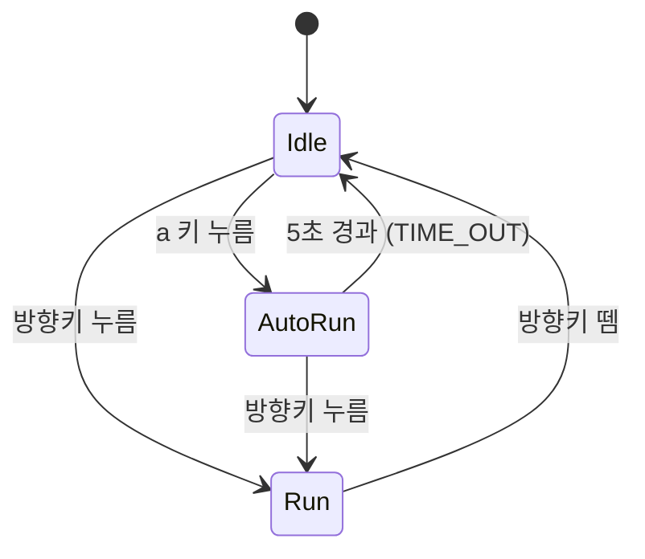

# PRD: Drill #11 — 소년 자동 무적 런(AutoRun) 상태 추가

## 1. 개요

기존 pico2d 기반 소년 캐릭터 프로젝트(Idle / Run 상태 머신)에 **AutoRun(자동 무적 런)** 상태를 새로 추가한다.
Idle 상태에서 `a` 키를 누르면 소년이 키 조작 없이 화면 좌우를 자동으로 왕복 이동하고,
일정 시간이 지나거나 방향키를 누르면 원래 상태로 돌아간다.

## 2. 목표

- 상태 패턴(State Pattern) 기반 상태 머신에 새 상태를 클래스로 추가하는 방법을 익힌다.
- 이벤트(키 입력, 타임아웃)에 따른 상태 전이를 정확히 구현한다.
- 구현 결과를 상태 다이어그램으로 문서화한다.

## 3. 범위

### 포함 (In scope)

- `AutoRun` 상태 클래스 신규 작성
- `a` 키 입력 이벤트 판별 함수 추가
- Idle ↔ AutoRun, AutoRun → Run 전이 추가
- 상태 다이어그램 이미지 작성 및 저장소에 포함

### 제외 (Out of scope)

- Run 상태에서 `a` 키로 AutoRun 진입 (요구사항에 없음)
- 실제 "무적" 판정(충돌 무시 등) 로직 — 이번 과제에는 충돌 대상이 없음
- 새 스프라이트 리소스 추가 (기존 run 애니메이션 재사용)

## 4. 상태 정의

| 상태                     | 설명                                    | 이동                    | 크기           |
| ------------------------ | --------------------------------------- | ----------------------- | -------------- |
| Idle                     | 제자리에서 대기                         | 없음                    | 기본           |
| Run                      | 방향키를 누르는 동안 해당 방향으로 이동 | 기본 속도               | 기본           |
| **AutoRun (신규)** | 키 조작 없이 좌우 자동 왕복 이동        | **기본보다 빠름** | **확대** |

## 5. 상태 전이

| 현재 상태 | 이벤트                | 다음 상태 | 비고            |
| --------- | --------------------- | --------- | --------------- |
| Idle      | `a` 키 누름         | AutoRun   | 진입 시각 기록  |
| AutoRun   | 진입 후 5초 이상 경과 | Idle      | 타임아웃        |
| AutoRun   | → 방향키 누름        | Run       | 오른쪽으로 이동 |
| AutoRun   | ← 방향키 누름        | Run       | 왼쪽으로 이동   |
| Idle      | 방향키 누름           | Run       | 기존 동작 유지  |
| Run       | 방향키 뗌             | Idle      | 기존 동작 유지  |

### 상태 다이어그램 (Mermaid)

## 6. 기능 요구사항

### FR-1. AutoRun 진입

- Idle 상태에서 `a` 키(`SDL_KEYDOWN`, `SDLK_a`)를 누르면 AutoRun 상태로 전이한다.
- 진입 시 현재 바라보는 방향(`face_dir`)으로 이동을 시작한다.
- 진입 시각을 `get_time()`으로 기록한다.

### FR-2. 자동 이동 및 방향 전환

- 키 입력 없이 매 프레임 현재 방향으로 계속 이동한다.
- 이동 속도는 Run 상태보다 빠르다. (예: Run 속도의 2배)
- 화면 왼쪽 끝(x ≤ 경계값) 또는 오른쪽 끝(x ≥ 800 − 경계값)에 닿으면 방향을 반대로 바꾼다.
- 방향이 바뀌면 스프라이트의 바라보는 방향도 함께 바뀐다.

### FR-3. 크기 확대

- AutoRun 상태에서 소년의 그리기 크기를 기본보다 크게 한다. (예: 1.5~2배)
- 확대 시 발이 땅(잔디) 아래로 파묻히지 않도록 y 좌표를 보정한다.

### FR-4. 타임아웃 복귀

- AutoRun 진입 후 5초 이상 지나면 `TIME_OUT` 이벤트를 발생시켜 Idle로 돌아간다.
- Idle 복귀 시 크기와 속도는 기본값으로 돌아간다.

### FR-5. 방향키로 취소

- AutoRun 중 방향키를 누르면 AutoRun이 즉시 취소되고, 누른 방향으로 움직이는 Run 상태가 된다.

### FR-6. 구현 방식 (필수)

- **반드시 `AutoRun` 상태 클래스를 별도로 추가해서 구현한다.**
- 기존 상태 클래스와 동일한 인터페이스를 가진다: `enter`, `exit`, `do`, `draw`
- Idle이나 Run 클래스 내부에 조건문으로 끼워 넣는 방식은 허용하지 않는다.

## 7. 기술 사항

- 언어/라이브러리: Python, pico2d
- 캔버스: 800 × 600
- 수정 대상 파일(예상): `boy.py` (상태 클래스, 전이 테이블), 이벤트 판별 함수 위치에 따라 `state_machine.py`
- 추가할 이벤트 판별 함수 예시: `a_down(e)` — `SDL_KEYDOWN` 이면서 키가 `SDLK_a`인지 확인
- 타이머: `get_time()`으로 진입 시각을 저장하고 `do()`에서 경과 시간 비교

## 8. 완료 기준 (Acceptance Criteria) 및 채점 대응

| 채점 항목                               | 배점 | 확인 방법                                     |
| --------------------------------------- | ---- | --------------------------------------------- |
| `a`를 누르면 AutoRun 상태로 이동      | 1점  | Idle에서 `a` 입력 시 키 조작 없이 이동 시작 |
| 5초 이상 경과하면 Idle 복귀             | 1점  | 아무 키도 누르지 않고 5초 후 제자리 대기      |
| AutoRun에서 속도가 빨라지고 크기가 커짐 | 1점  | Run과 비교해 확실히 빠르고 큼                 |
| AutoRun에서 좌우 끝 자동 방향 전환      | 1점  | 양쪽 끝에서 화면 밖으로 나가지 않고 반전      |
| 상태 다이어그램                         | 1점  | 저장소에 이미지 파일 포함                     |

추가 확인 사항:

- AutoRun 중 방향키를 누르면 해당 방향 Run으로 전환된다.
- 기존 Idle ↔ Run 동작이 깨지지 않는다.

## 9. 제출물

- 소스 코드 전체 (GitHub 저장소)
- **상태 다이어그램 이미지 파일** (예: `state_diagram.png`) — 저장소에 반드시 포함
- 제출 방식은 디스코드에 공지된 실습 과제 제출 요령을 따른다.

## 10. 작업 계획 및 커밋 규칙

작업 단계마다 한국어 짧은 문장으로 커밋한다.

1. `a` 키 이벤트 판별 함수 추가 → 커밋: `a 키 이벤트 추가`
2. AutoRun 클래스 뼈대 작성 → 커밋: `AutoRun 상태 클래스 추가`
3. 자동 이동과 좌우 방향 전환 구현 → 커밋: `자동 이동 및 방향 전환 구현`
4. 속도 증가와 크기 확대 적용 → 커밋: `AutoRun 속도와 크기 적용`
5. 5초 타임아웃 복귀 구현 → 커밋: `5초 후 Idle 복귀 구현`
6. 방향키로 Run 전환 구현 → 커밋: `방향키로 Run 전환 구현`
7. 상태 다이어그램 이미지 추가 → 커밋: `상태 다이어그램 추가`

## 11. 참고

- AI 사용 개발 허용 과제임.
